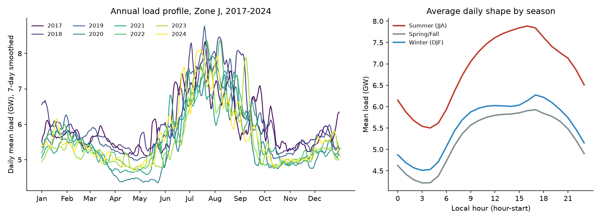
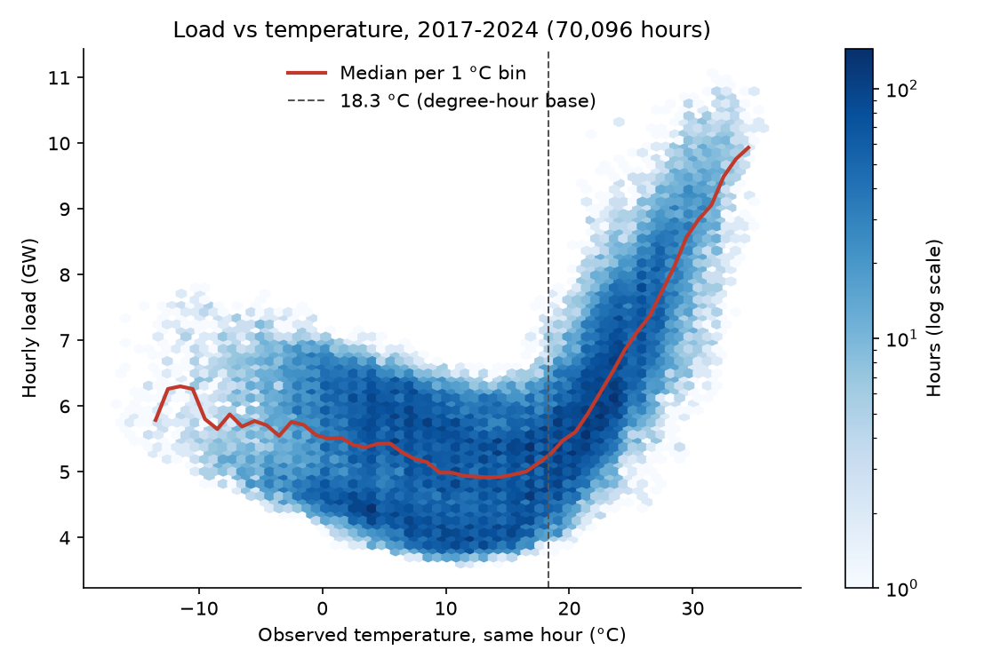
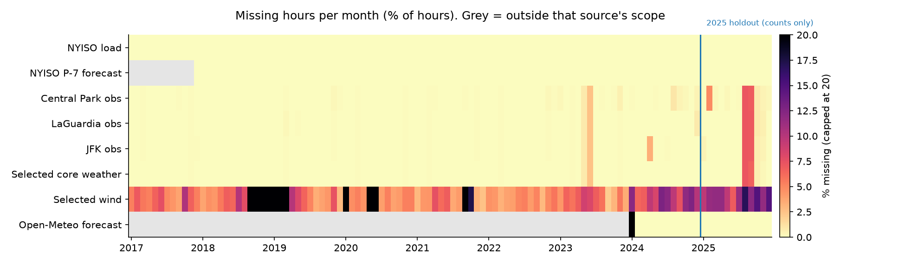

# Full-history data audit (Step 9)

Generated by `scripts/audit_full_history.py` from the Step 8 silver tables and the raw NOAA files. Row-level evidence is written to `outputs/data_audit/step9/` (kept local).

## Scope and holdout rule

- Period: local years 2017-2025, 78,888 expected UTC hours (DST days have 23 or 25 hours).
- 2025 is the final holdout. It appears only as counts: rows, missing hours, fallback hours, timestamp disagreements and quarantined rows.
- Load and weather values, value checks and figures use 2017-2024 only (70,128 hours). The code refuses 2025 rows in any value-based check.
- No models were fitted and no forecast errors were computed. The protocol (contract v0.2, Amendment 1) was frozen before this audit, so nothing here changes model or feature choices.

## Coverage by year

Counts of hours. 'Weather core missing' = no station had a complete temperature, dew point and humidity reading in that hour. 'Fallback' = Central Park lacked the core reading and LaGuardia (then JFK) supplied it. 'Precip unknown' excludes trace reports, which are kept as a separate flag.

| Year | Expected hours | Load missing | Load duplicates | Weather core missing | Fallback LGA | Fallback JFK | Wind missing | Precip unknown | Precip trace | P-7 expected | P-7 missing | Open-Meteo rows | Open-Meteo null |
| --- | --- | --- | --- | --- | --- | --- | --- | --- | --- | --- | --- | --- | --- |
| 2017 | 8760 | 0 | 0 | 1 | 5 | 0 | 532 | 3 | 249 | 720 | 0 | 0 | 0 |
| 2018 | 8760 | 0 | 0 | 0 | 3 | 0 | 2450 | 28 | 447 | 8760 | 0 | 0 | 0 |
| 2019 | 8760 | 0 | 0 | 1 | 33 | 1 | 2106 | 241 | 443 | 8760 | 0 | 0 | 0 |
| 2020 | 8784 | 0 | 0 | 2 | 25 | 0 | 1316 | 45 | 464 | 8784 | 0 | 0 | 0 |
| 2021 | 8760 | 0 | 0 | 1 | 5 | 1 | 843 | 93 | 415 | 8760 | 0 | 0 | 0 |
| 2022 | 8760 | 0 | 0 | 1 | 6 | 0 | 389 | 142 | 434 | 8760 | 0 | 0 | 0 |
| 2023 | 8760 | 0 | 0 | 26 | 7 | 0 | 492 | 151 | 421 | 8760 | 0 | 0 | 0 |
| 2024 | 8784 | 0 | 0 | 0 | 65 | 0 | 876 | 63 | 434 | 8784 | 0 | 8784 | 468 |
| 2025 (holdout) | 8760 | 0 | 0 | 108 | 44 | 0 | 1041 | 3035 | 386 | 8760 | 0 | 8760 | 0 |

- Load: 0 missing hours and 0 duplicate hours across the full period. No load value was imputed.
- Observed weather: 140 hours with no core reading at any station; 195 hours used a backup station (193 LaGuardia, 2 JFK).
- Wind is missing in 10,045 hours (12.7%), which is why it is excluded from feature set C.
- NYISO P-7: 0 missing hours from 2017-12-02 onward.
- Open-Meteo archived forecasts: 468 null hours, all before the first available valid time (2024-01-20 12:00 UTC).

- 2025 (holdout, counts only) has more gaps than earlier years: 108 hours with no core weather and 3,035 hours with unknown precipitation. Precipitation is not a model input; the core-weather gaps show up as missing feature-set C inputs, which Step 10 counts. This is recorded now so the final evaluation reports it.

## NOAA station timing by year

'No obs' = hours with no routine (FM-15) observation from that station. 'Quarantined' = FM-15 rows whose original METAR UTC time could not be recovered; they are excluded, never re-timed from DATE. 'DATE disagrees' = recovered METAR UTC time differs from the LCD DATE read as fixed EST (DATE + 5 h).

| Year | Central Park no obs | Central Park quarantined | Central Park DATE disagrees | LaGuardia no obs | LaGuardia quarantined | LaGuardia DATE disagrees | JFK no obs | JFK quarantined | JFK DATE disagrees |
| --- | --- | --- | --- | --- | --- | --- | --- | --- | --- |
| 2017 | 3 | 0 | 9 | 2 | 2 | 10 | 3 | 0 | 10 |
| 2018 | 0 | 0 | 10 | 0 | 0 | 10 | 0 | 0 | 10 |
| 2019 | 4 | 28 | 9 | 4 | 12 | 9 | 2 | 2 | 8 |
| 2020 | 2 | 1 | 10 | 2 | 1 | 10 | 2 | 0 | 10 |
| 2021 | 4 | 0 | 8 | 2 | 0 | 8 | 2 | 0 | 9 |
| 2022 | 4 | 0 | 9 | 2 | 0 | 10 | 2 | 0 | 9 |
| 2023 | 33 | 0 | 10 | 26 | 0 | 10 | 26 | 0 | 10 |
| 2024 | 17 | 0 | 10 | 6 | 1 | 10 | 25 | 0 | 10 |
| 2025 (holdout) | 152 | 0 | 10 | 114 | 0 | 10 | 115 | 0 | 10 |

- Over 2017-2025, 258 of 236,210 resolved FM-15 rows (0.11%) disagree with DATE + 5 h: 128 by +60 minutes, 130 by -60 minutes and 0 by other amounts.
- Every disagreement falls within 4.2 hours of a DST change (+60 in March, -60 in November), confirming the pilot finding that DATE is not a clean fixed-EST clock near DST. The silver tables use the METAR UTC time, so these rows are timed correctly.
- Quarantined FM-15 rows: 47 in total (Central Park 29, LaGuardia 16, JFK 2).

## Load value checks, 2017-2024

- Non-positive or non-finite values and flat runs (identical consecutive values for 3 or more hours) would indicate meter or feed problems.
- Deviation flags compare each hour with the median of the same clock hour 1-3 days before and after; hours with a robust z-score above 6 are flagged for review, not removed.

| Year | Min MW | Mean MW | Max MW | Peak hour start (local) | Max hourly change MW | Deviation flags | Non-positive | Flat runs >= 3 h |
| --- | --- | --- | --- | --- | --- | --- | --- | --- |
| 2017 | 3,892 | 5,966 | 10,671 | 2017-07-20 16:00 | 874 | 54 | 0 | 0 |
| 2018 | 3,774 | 6,091 | 11,070 | 2018-09-06 16:00 | 800 | 0 | 0 | 0 |
| 2019 | 3,826 | 5,936 | 10,802 | 2019-07-17 17:00 | 692 | 13 | 0 | 0 |
| 2020 | 3,604 | 5,471 | 10,150 | 2020-07-28 15:00 | 787 | 0 | 0 | 0 |
| 2021 | 3,649 | 5,574 | 10,352 | 2021-06-30 15:00 | 865 | 5 | 0 | 0 |
| 2022 | 3,732 | 5,678 | 10,830 | 2022-08-09 16:00 | 712 | 10 | 0 | 0 |
| 2023 | 3,708 | 5,511 | 10,372 | 2023-09-06 16:00 | 633 | 0 | 0 | 0 |
| 2024 | 3,744 | 5,658 | 10,245 | 2024-07-16 17:00 | 694 | 2 | 0 | 0 |

11 local days contain deviation flags. Their daily maximum temperature shows whether weather explains them:

| Local day | Flagged hours | Max abs z | Mean deviation | Daily max temp (°C) |
| --- | --- | --- | --- | --- |
| 2017-05-18 | 14 | 7.8 | 43.1% | 33.3 |
| 2017-05-19 | 24 | 8.2 | 42.9% | 32.2 |
| 2017-06-13 | 11 | 6.8 | 37.3% | 34.4 |
| 2017-06-14 | 1 | 6.0 | 35.2% | 28.9 |
| 2017-09-05 | 4 | 6.3 | 36.2% | 28.9 |
| 2019-09-04 | 4 | 6.3 | 36.2% | 29.4 |
| 2019-10-02 | 9 | 7.9 | 41.4% | 33.3 |
| 2021-07-03 | 2 | 6.1 | -35.5% | 18.9 |
| 2021-07-04 | 3 | 6.0 | -35.0% | 25.6 |
| 2022-05-31 | 10 | 6.9 | 37.9% | 33.3 |
| 2024-08-28 | 2 | 6.1 | 35.3% | 32.2 |

9 days are above their neighbors; all are hot days (daily maximum 28.9-34.4 °C) whose load rose well above the same hours on nearby days. 2 days are below their neighbors: 2021-07-03, 2021-07-04. No flagged hour is zero, negative or part of a flat run, so all hours stay in the data; forecasting such days is part of the task.

## Weather value checks, 2017-2024

Selected hourly weather (Central Park first, then backups) against plausible NYC ranges:

| Check | Rows checked | Flagged |
| --- | --- | --- |
| temperature_c outside [-30, 45] | 70096 | 0 |
| dewpoint_c outside [-40, 35] | 70096 | 0 |
| relative_humidity_pct outside [1, 100] | 70096 | 0 |
| wind_speed_m_s outside [0, 40] | 61124 | 0 |
| precipitation_mm outside [0, 100] | 66055 | 0 |
| dewpoint_c > temperature_c + 0.5 | 70096 | 0 |

## Figures

Figure 1. Zone J daily mean load by day of year for 2017-2024 (7-day smoothed), and the average daily shape by season. Summer peaks dominate; winter shows a smaller evening peak.

Figure 2. Hourly load against same-hour observed temperature, 2017-2024. The U shape (heating below and cooling above about 18 °C) motivates the heating and cooling degree-hour features.

Figure 3. Missing hours per month for each source. Grey cells are outside that source's scope (P-7 before December 2017; Open-Meteo before 2024). 2025 is shown as counts only.

## Conclusions for the paper

- The load target is complete for all 78,888 hours, with no duplicates or imputation.
- Observed weather uses a backup station in 0.25% of hours and has no core reading in 0.18%.
- Station timing is reconstructed from METAR UTC tokens; DATE disagreements are rare and handled.
- Load departures flagged by the robust check coincide with weather extremes or holidays, not faults.

## Limits

- NYISO load is the current retrieved vintage, not the first-published value; historical revisions are not observable here.
- NOAA LCD routine observations are not fully quality-controlled upstream; range checks flag but do not fix.
- Publication delays (1 h load, 15 min weather) are assumptions from the frozen protocol, not measured.
